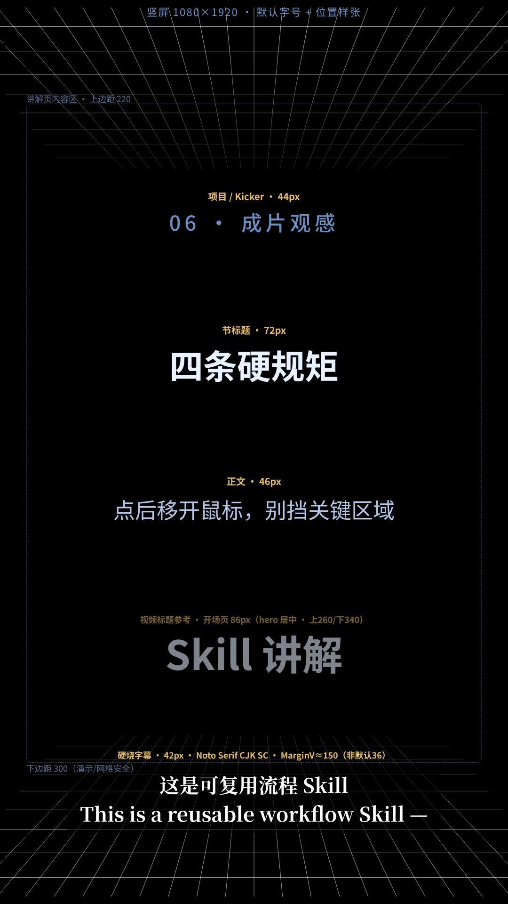

# GridVideoSkill · 网格视频生成

面向 coding agent / Grok Bot 的 **竖屏 Remotion 技术说明片 Skill**：黑底 + 天花板/地板网格、讲解文案、旁白与示例演示。

本仓库与 [WebVideoCap](https://github.com/pdhxr/WebVideoCap/)（网页操作录屏 Skill）平行，互不嵌套。

## 给 Agent（省 token）

不要通读整支视频。片尾或本页只要这一行：

```
SKILL_URL=https://raw.githubusercontent.com/pdhxr/GridVideoSkill/main/SKILL.md
```

```bash
curl -fsSL "$SKILL_URL" -o SKILL.md
```

把 `SKILL.md`（及同仓库组件包，若需要）装进 agent skills / workflows 后按文档执行。

Skill 名称：`网格视频生成skill`

## 给人看

讲解视频用来**看效果、做选择**，不是逐步照做的教程。选定后让 Agent 下载本 Skill 执行。

演示说明视频目前在平行仓：[WebVideoCap `readme.mp4`](https://github.com/pdhxr/WebVideoCap/blob/main/readme.mp4)（竖屏，硬烧中英字幕）。旁白文稿见 [`docs/网格视频生成skill-演示说明视频-旁白脚本-中英.md`](./docs/网格视频生成skill-演示说明视频-旁白脚本-中英.md)。

## 它做什么

- Remotion 竖屏 1080×1920；DualRetroGrid + SceneLayout（blurInUp）
- 专用工程目录、确认门禁、演示加速、旁白去重、总结收尾（技术 + 工程卫生）
- 硬烧录字幕；定稿后整理只留一份成片
- 可移植组件包 + Magic UI / Remotion 来源说明

完整流程见 [`SKILL.md`](./SKILL.md)。

## 许可

[MIT License](./LICENSE)。

## 字号样张

默认成片 **1080×1920 竖屏**。一眼对照默认字号（勿把 36px 当默认）：



| 角色 | 默认 | 字体 |
| --- | --- | --- |
| 视频标题 | 86px | Noto Sans SC |
| 节标题 | 72px | Noto Sans SC |
| 项目 / Kicker | 44px | Noto Sans SC |
| 正文 | 46px | Noto Sans SC |
| 硬烧字幕 | **42px** | Noto Serif CJK SC（36 仅下限） |
